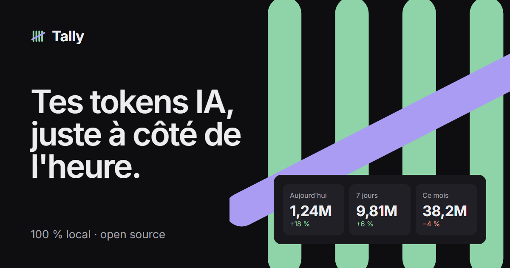

# Tally

**Your AI tokens, right next to the clock.**

Tally lives in the Windows taskbar and counts the tokens you burn with your AI coding agents, by day, week and month. Everything is read locally: no API, no key, no account.

[Download for Windows](https://github.com/erwancodes/tally/releases/latest) · [tally.erwanx.com](https://tally.erwanx.com)



## What it does

- A system tray icon, with a `Today: 1.2M tokens` tooltip on hover.
- One click opens the window: today, 7 days, current month, a 30-day chart, and a breakdown by agent and by model.
- Input, output, cache read and cache write, with a setting to count cache or not.
- Live updates while an agent writes.
- Optional launch at Windows startup.
- Updates itself when a new version is out.

## Agents

| Agent | Files read | Status |
| --- | --- | --- |
| Claude Code | `~\.claude\projects\**\*.jsonl` | Supported |
| Codex CLI | `~\.codex\sessions\**\rollout-*.jsonl` | Supported |
| OpenCode | `~\.local\share\opencode\opencode.db` (and legacy `storage\message\**\*.json`) | Supported |
| Kimi Code | `~\.kimi\sessions\**\wire.jsonl` | Supported |
| Grok CLI | `~\.grok\sessions\**\usage.json` | Supported |
| Cursor | `%APPDATA%\Cursor\User\globalStorage\state.vscdb` | Partial: Cursor saves token counts for only some messages |

Your agent isn't there? [Add it](docs/ADD_A_PROVIDER.md), it's one Rust file.

## Install

Download the `.msi` or `.exe` from the [latest release](https://github.com/erwancodes/tally/releases/latest) and run it. Windows 10 or 11.

From 0.2.0 on, Tally checks GitHub for new versions and offers to install them in one click. If you are on 0.1.x, install 0.2.0 over it once; your data is kept.

## FAQ

**Does my data leave my PC?**
No. Tally reads the logs your agents already write to your disk and only keeps counters in `%APPDATA%\Tally\tally.db`. The only network request is the update check against GitHub Releases. No telemetry.

**Does Tally change my agents' files?**
No, it only reads them.

**macOS and Linux?**
Not yet. Tally is built with Tauri, so it is possible later.

## Develop

You need Node 22+, stable Rust and the [Tauri prerequisites for Windows](https://v2.tauri.app/start/prerequisites/).

```bash
npm install
npm run tauri dev
```

Tests:

```bash
npm test
cd src-tauri && cargo test
```

Release build (`.msi` and `.exe` in `src-tauri/target/release/bundle/`):

```bash
npm run tauri build
```

Outside Tauri (`npm run dev`), the front end shows demo data.

### Layout

```
src/              React + TypeScript + Tailwind front end
src-tauri/src/
  providers/      one file per agent
  store.rs        SQLite, incremental reads, dedup
  watcher.rs      watches the agents' folders
  tray.rs         icon, tooltip and menu
fixtures/         scrubbed sessions for tests
landing/          tally.erwanx.com, static page
```

## License

MIT, see [LICENSE](LICENSE). Made by [@ErwanCodes](https://x.com/ErwanCodes).
